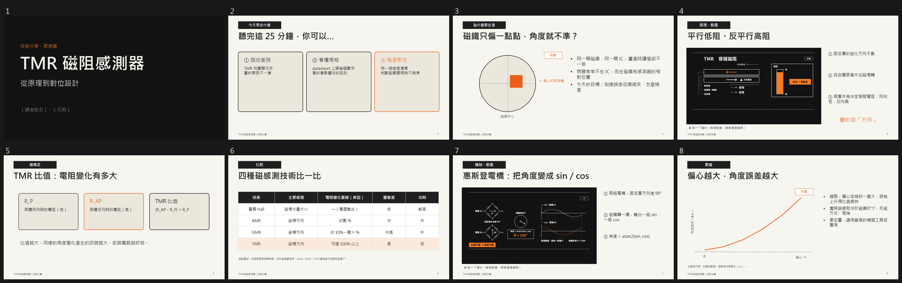
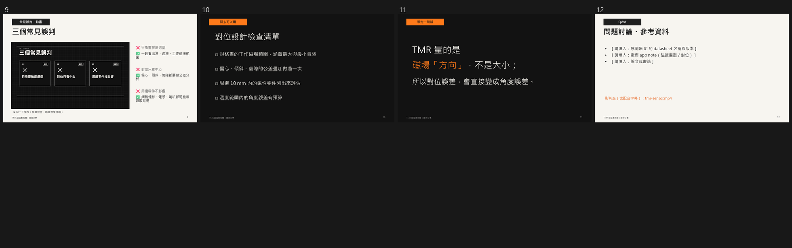
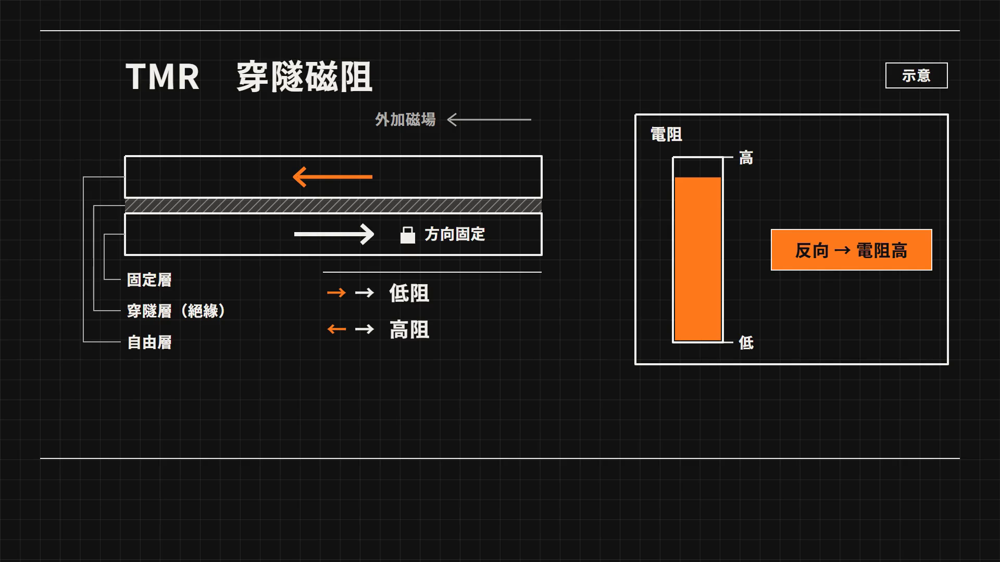
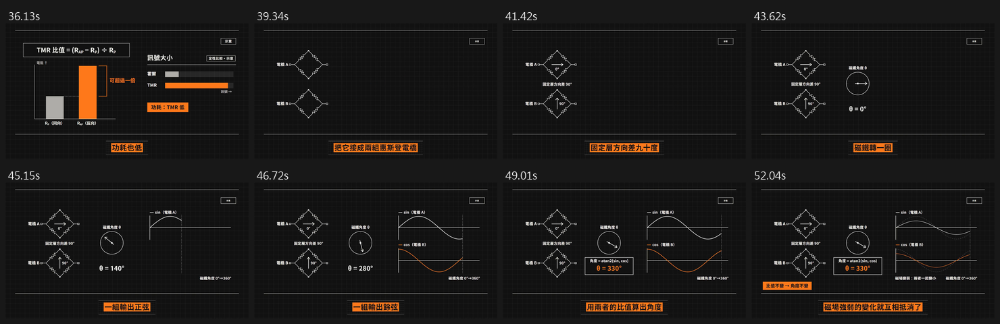

# rd-motion-deck

**研發知識分享的動畫簡報：一次製作，兩份成品。**

| 成品 | 內容 | 給誰用 |
|---|---|---|
| **A 簡報**（.pptx） | 技術分享簡報。2–4 個關鍵機制頁嵌入動畫片段，片段靜音、沒有字幕，講者邊播邊講 | 現場分享、讀書會 |
| **B 影片**（MP4） | 同一份內容的完整解說片：配音、字幕、三色主題 | 沒到場的同事、新人訓練、會前預讀 |

動畫只做一次：先做 B 影片，再從它的「靜音孿生版」剪出機制頁的片段嵌進簡報，兩邊的秒數、用語、顏色完全一致。

這是給 Claude Code（以及 Codex 等讀得懂 `SKILL.md` 的 AI agent）用的 skill，改寫自 [mathruffian-dot/soil-motion-deck](https://github.com/mathruffian-dot/soil-motion-deck)（給老師用的動畫教學簡報），把內容架構從課堂教學換成研發知識分享。

> **給 AI agent**：使用者要你安裝這個 repo 時，請照 [AGENT_INSTALL.md](AGENT_INSTALL.md) 的步驟做。

## 範例：〈TMR 磁阻感測器：從原理到對位設計〉

簡報 12 頁，第 4、7、9 頁是動畫頁；影片 92 秒、7 格。




第 4 頁動畫的封面（停在結論畫面）：



影片審查截圖（惠斯登電橋那一段，每個旁白子句截一格）：



## 安裝

### 最簡單：把這個 repo 連結交給你的 AI agent

在 Claude Code（或 Codex）裡說：

```text
幫我安裝這個 skill：https://github.com/tedchen0814/rd-motion-deck
```

Agent 會讀 [AGENT_INSTALL.md](AGENT_INSTALL.md)，執行一鍵安裝腳本，最後回報環境檢查結果。

### 自己執行一鍵安裝腳本

**Windows（PowerShell）**，不用先下載 repo：

```powershell
& ([scriptblock]::Create((irm https://raw.githubusercontent.com/tedchen0814/rd-motion-deck/main/install.ps1)))
```

**macOS／Linux／Git Bash**：

```bash
curl -fsSL https://raw.githubusercontent.com/tedchen0814/rd-motion-deck/main/install.sh | bash
```

已經 clone 下來的話，在 repo 資料夾裡執行 `powershell -ExecutionPolicy Bypass -File .\install.ps1` 或 `bash install.sh`。

> **公司電腦出現「未經數位簽署」錯誤**：公司群組原則常把執行原則設成 `RemoteSigned`，`-ExecutionPolicy Bypass` 也蓋不過去，放在雲端硬碟或網路磁碟上的 `.ps1` 會被擋。改用上面不需下載的那行指令，或把 repo clone 到本機磁碟（例如 `C:\`）再執行。

### 腳本會裝什麼

| 項目 | 版本 | 來源 |
|---|---|---|
| `rd-motion-deck` | 本 repo | 本 repo |
| `motion-explainer`、`motion-design`、`review-loop` | 測試過的 commit `94dd90b` | [mathruffian-dot/claude-motion-explainer](https://github.com/mathruffian-dot/claude-motion-explainer) |
| HyperFrames CLI | 0.8.168 | npm |
| HyperFrames 官方 skills（`hyperframes`、`hyperframes-*`、`media-use`、`faceless-explainer`，共 11 個） | 固定 commit `207c8a4` | [heygen-com/hyperframes](https://github.com/heygen-com/hyperframes) |
| Python 套件 `edge-tts`、`pillow`、`fonttools`、`brotli` | 最新 | pip |

Skills 裝在 `~/.claude/skills/`（Claude Code）。已經有同名 skill 時，舊版會先移到 `~/.claude/skill-backups/<日期時間>/`，不會覆蓋掉。

#### 為什麼 HyperFrames skills 要固定版本

HyperFrames 在 2026-10-21 把 `faceless-explainer` 等「workflow skills」下架了（[heygen-com/hyperframes@6882293](https://github.com/heygen-com/hyperframes/commit/68822931)），但 motion-explainer 做影片的整條流程都靠它。所以：

- 安裝腳本從下架前一個 commit（`207c8a4`）安裝這 11 個 skill，**不使用** `hyperframes skills update`（它會刪掉已下架的 skill）。
- 腳本會設定使用者環境變數 `HYPERFRAMES_SKIP_SKILLS=1`。不設的話，每次 `hyperframes init` 都會向 GitHub 同步，把核心 skill 換成新版，和舊版的 `faceless-explainer` 混在一起。
- 不要另外執行 `hyperframes skills update`。不小心執行了，重跑一次本安裝腳本就能恢復。

### 需要先有的工具

Git、Node.js 22 以上、ffmpeg、Python 3.9 以上。腳本會先檢查，缺少時列出安裝指令後停止。Windows 加上 `-InstallPrereqs` 可以讓腳本用 winget 自動安裝。

### 腳本選項

| PowerShell | Bash | 作用 |
|---|---|---|
| `-Agent codex` | `--agent codex` | 裝到 `~/.agents/skills/`（Codex）；`both` 兩邊都裝 |
| `-InstallPrereqs` | — | 用 winget 安裝缺少的 Git、Node.js、ffmpeg、Python |
| `-Latest` | `--latest` | 用 claude-motion-explainer 的最新版，而不是測試過的版本 |
| `-DisableTelemetry` | `--disable-telemetry` | 關閉 HyperFrames 的匿名使用統計（預設開啟） |
| `-SkipHyperFrames` | `--skip-hyperframes` | 不安裝 HyperFrames（只能做簡報架構，不能做影片） |
| `-CheckOnly` | `--check-only` | 只檢查已安裝的東西，不做任何修改 |

用 `irm` 執行時帶選項的寫法：

```powershell
& ([scriptblock]::Create((irm https://raw.githubusercontent.com/tedchen0814/rd-motion-deck/main/install.ps1))) -InstallPrereqs -DisableTelemetry
```

### 字型（選用）

簡報預設用[源石黑體](https://github.com/ButTaiwan/genseki-font)。播放的電腦沒裝的話，請在 `build_deck.js` 改用微軟正黑體（skill 會自動提醒）；影片的字型會打包在影片裡，不受影響。

### 更新

重新執行一次安裝腳本即可，舊版會自動備份。

## 怎麼用

安裝完重新啟動 agent，然後直接描述你的分享：

```text
/rd-motion-deck 下週讀書會分享 ESD 防護設計，30 分鐘，聽眾是 EE 和 ME，放電路徑那頁要做成動畫
```

不打 `/rd-motion-deck` 也可以，提到「技術分享簡報＋動畫／解說影片」時 agent 會自動使用。

Agent 會：

1. 一次問完：主題範圍、聽眾、時間、帶走一句話、手上的素材、要哪幾份成品、配色。
2. 排出故事線和頁面角色表，標出要做動畫的頁（🎬），給你確認。
3. 寫旁白、產生配音、平行製作每一格動畫、組裝、字幕、套色、審查。
4. 輸出 B 影片，剪出 🎬 片段，做出 A 簡報，輸出縮圖逐頁檢查。
5. 交付時列出片長、封面、待你補的地方（例如參考資料）。

只要影片、不要簡報時，用 `/motion-explainer`。

## 和原版 soil-motion-deck 的差別

| 位置 | soil-motion-deck（教學） | rd-motion-deck（研發知識分享） |
|---|---|---|
| 開場訪談 | 科目、年級、一節課 | 主題範圍、聽眾、時間、帶走一句話、素材 |
| 內容架構 | SOIL 教學六引擎 | 開場 → 為什麼要在意 → 原理 🎬 → 實務 → 常見誤判 🎬 → 檢查清單 → 帶走一句話 → Q&A |
| 動畫題材 | 證明、數方格 | 物理機制、訊號時序、電流路徑、參數掃描、機構組裝、測試流程 |
| 講者備註 | 提問學生、練習題答案 | 預期問題與回答、數據來源與條件、可略的頁 |
| 圖表規則 | — | 自己畫的波形與曲線一律標「示意」；規格數字標「典型值」與出處 |
| 範例 | 畢氏定理 | TMR 磁阻感測器 |

## Repo 內容

| 路徑 | 用途 |
|---|---|
| `skills/rd-motion-deck/SKILL.md` | 完整流程：訪談 → 故事線與 🎬 頁 → 影片腳本交接 → 靜音孿生版剪片 → 簡報 → 審查 → 交付 |
| `skills/rd-motion-deck/references/rd-structure.md` | 頁面角色與版型、依聽眾調整、分領域動畫題材清單、示意圖畫法 |
| `skills/rd-motion-deck/references/lessons.md` | 實作踩過的坑（含兩次完整測試的紀錄） |
| `skills/rd-motion-deck/scripts/` | 靜音孿生版、剪片、投影片縮圖（沿用原版） |
| `skills/rd-motion-deck/templates/` | PptxGenJS 共用元件、TMR 範例簡報 |
| `install.ps1`、`install.sh` | 一鍵安裝腳本 |
| `AGENT_INSTALL.md` | 給 AI agent 的安裝步驟 |

## 授權

[MIT](LICENSE)。原作與第三方元件見 [NOTICE.md](NOTICE.md)。
